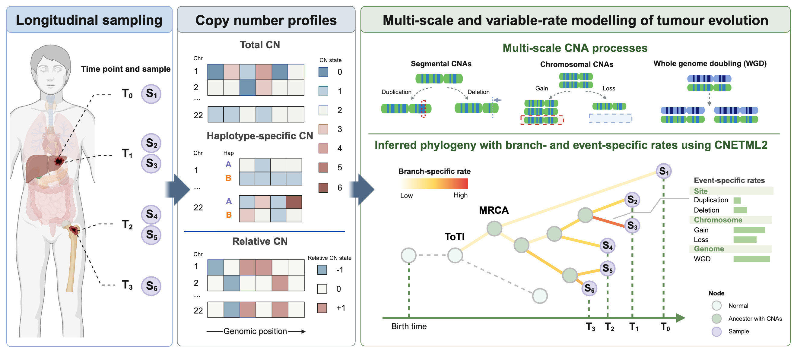

<p align="center">
  <picture>
    <source media="(prefers-color-scheme: dark)" srcset="assets/logo/svg/cneta-logo-dark.svg">
    
  </picture>
</p>

Copy Number Evolutionary Tree Analysis (Version 2)
=============

## Introduction
This repository contains a set of programs to simulate and build phylogenetic trees from copy number alterations (CNAs) detected from whole genome sequencing of multiple samples of a patient.


There are mainly 3 programs:
* **cnets**: simulating CNAs along a phylogenetic (coalescence) tree
* **cnetml**: building phylogenetic trees from copy numbers with maximum likelihood approach, capable of jointly inferring the tree topology, node ages, and mutation rates from total copy number of longitudinal samples
* **cnetmcmc** (still under development): building phylogenetic trees from copy numbers with Bayesian MCMC approach

For installation, usage, and full documentation, see our website: https://lu-cbio-group.github.io/cneta2/

## Installation

Everything is installed with conda:

| File | Environment | What it is for |
|---|---|---|
| `envs/environment-mac.yml` | `cneta-build` | Build and run the programs on macOS |
| `envs/environment-linux.yml` | `cneta-build` | Build and run the programs on Linux, HPC with conda, Windows via WSL |
| `envs/environment-util.yml` | `cneta-util` | Optional: plotting and other scripts in `util/` |

```bash
conda env create -f envs/environment-mac.yml     # or envs/environment-linux.yml
conda activate cneta-build
cd code && ./build.sh local 4                     # programs are written to bin/
```

HPC without conda, Windows, plotting and tests: see the [installation guide](https://lu-cbio-group.github.io/cneta2/en/installation/index.html).


## Overview
<p align="center">
  <a href="assets/briefing/briefing.jpeg" target="_blank">
    <picture>
    
    </picture>
  </a>
</p>

**Overview of CNETML2.** Tumour samples collected from a patient at successive time points are summarised as copy-number profiles, from which CNETML2 infers a time-scaled phylogeny. The input can be any one of three profile types: total, haplotype-specific or relative copy number. With total or haplotype-specific input, change is modelled at three scales: segmental duplication and deletion, chromosome gain and loss, and whole-genome doubling (WGD); relative input uses the segment level only. Each event type has a rate of its own, and rates can stay constant across the tree or differ between branches, for example under a random local clock (RLC), where a shift on one branch is inherited by its descendants. Every branch therefore carries its own set of event-specific rates, shown for one branch as an example; the tree and rates are illustrative.

*CN*: copy number. *CNA*: copy-number alteration. *Chr*: chromosome. *Hap*: haplotype. *T* and *S*: sampling time point and tumour sample. *Birth time*: the patient's birth, when the genome still has a normal copy number. *ToTI* (time of tumour initiation): the last common ancestor that still has a normal copy number, and the root of the tree in the model. *MRCA*: the most recent common ancestor of all tumour samples.

## Version and citation

The first version of this repository is at https://github.com/ucl-cssb/cneta.

If you use **cnets** or **cnetml**, please cite:
- [Lu B, Curtius K, Graham TA, Yang Z, Barnes CP. CNETML: maximum likelihood inference of phylogeny from copy number profiles of multiple samples. Genome Biol 24, 144 (2023).](https://doi.org/10.1186/s13059-023-02983-0)

The cnetml2 paper is currently in preparation; a citation will be added here once it is available.

Once releases are archived on Zenodo, each release will also have a DOI
for citing the software itself. The citation data lives in `CITATION.cff`;
the developer guide's page on versions and releases says how to update it.