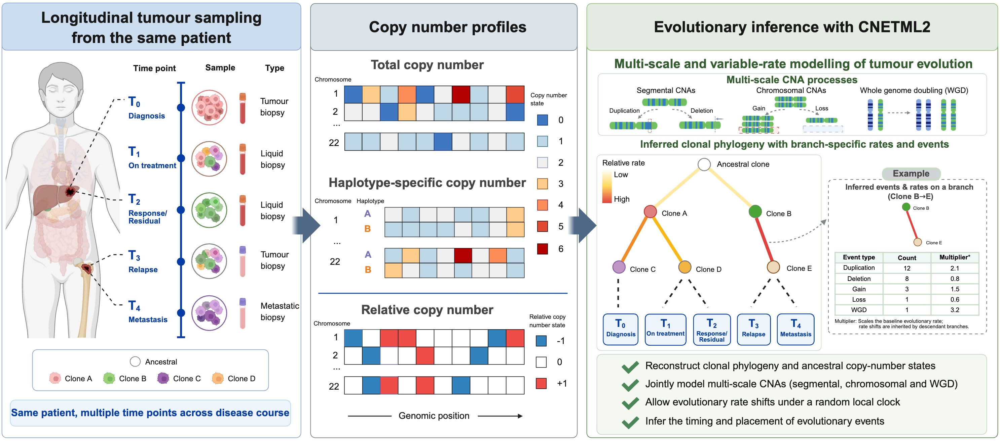

<p align="center">
  <picture>
    <source media="(prefers-color-scheme: dark)" srcset="assets/logo/svg/cneta-logo-dark.svg">
    
  </picture>
</p>

Copy Number Evolutionary Tree Analysis (Version 2)
=============

## Introduction
This repository contains a set of programs to simulate and build phylogenetic trees from copy number alterations (CNAs) detected from whole genome sequencing of multiple samples of a patient.


There are mainly 3 programs:
* **cnets**: simulating CNAs along a phylogenetic (coalescence) tree
* **cnetml**: building phylogenetic trees from copy numbers with maximum likelihood approach, capable of jointly inferring the tree topology, node ages, and mutation rates from total copy number of longitudinal samples
* **cnetmcmc** (still under development): building phylogenetic trees from copy numbers with Bayesian MCMC approach

For installation, usage, and full documentation, see our website: https://lu-cbio-group.github.io/cneta2/

## Installation

Everything is installed with conda:

| File | Environment | What it is for |
|---|---|---|
| `code/environment-mac.yml` | `cneta-build` | Build and run the programs on macOS |
| `code/environment-linux.yml` | `cneta-build` | Build and run the programs on Linux, HPC with conda, Windows via WSL |
| `util/environment.yml` | `cneta-util` | Optional: plotting and other scripts in `util/` |

```bash
conda env create -f code/environment-mac.yml     # or code/environment-linux.yml
conda activate cneta-build
cd code && ./build.sh local 4                     # programs are written to bin/
```

HPC without conda, Windows, plotting and tests: see the [installation guide](https://lu-cbio-group.github.io/cneta2/en/installation/index.html).


## Overview
<p align="center">
  <a href="assets/briefing/briefing.jpeg" target="_blank">
    <picture>
    
    </picture>
  </a>
</p>

CNETML2 takes longitudinal copy number profiles (total, haplotype-specific, and relative) from multiple samples of the same patient and jointly models segmental, chromosomal, and whole-genome-doubling changes to reconstruct a clonal phylogeny with branch-specific evolutionary rates and event timing.

## Version and citation

The first version of this repository is at https://github.com/ucl-cssb/cneta.

If you use **cnets** or **cnetml**, please cite:
- [Lu B, Curtius K, Graham TA, Yang Z, Barnes CP. CNETML: maximum likelihood inference of phylogeny from copy number profiles of multiple samples. Genome Biol 24, 144 (2023).](https://doi.org/10.1186/s13059-023-02983-0)

The cnetml2 paper is currently in preparation; a citation will be added here once it is available.