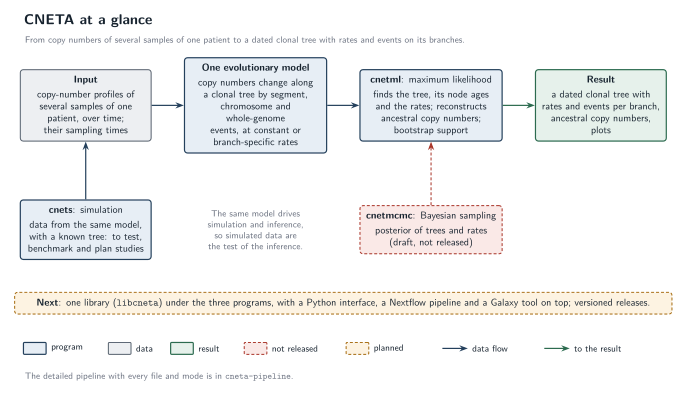
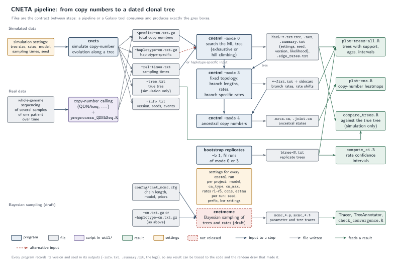

# CNETA pipeline figures

Two figures, drawn in TikZ the same way as the logo in `../logo/`, so they
live under version control and come in a light and a dark variant. **Drafts
for discussion with the research team; the documentation does not use them
yet.**

## At a glance

<p align="center">
  <picture>
    <source media="(prefers-color-scheme: dark)" srcset="svg/cneta-overview-dark.svg">
    
  </picture>
</p>

What the tools do, on one line: input, the one evolutionary model, maximum
likelihood inference, the result; simulation from the same model; the
Bayesian sampler as a draft; and what comes next. Source:
`cneta-overview.tex`.

## The pipeline in detail

<p align="center">
  <picture>
    <source media="(prefers-color-scheme: dark)" srcset="svg/cneta-pipeline-dark.svg">
    
  </picture>
</p>

How the programs and the `util/` scripts chain together, and which files
cross the boundaries between them. Source: `cneta-pipeline.tex`.

| Use | File |
|---|---|
| Light background | `svg/cneta-overview.svg`, `svg/cneta-pipeline.svg` |
| Dark background | `svg/cneta-overview-dark.svg`, `svg/cneta-pipeline-dark.svg` |
| Slides, chat | `png/` (generated locally by `./build.sh`, not committed) |

## Reading it

- **Blue** boxes are the programs (`cnets`, `cnetml` in its modes), **purple**
  the scripts in `util/`, **grey** the files that pass between them, **green**
  the results people look at, **amber** the settings to choose, **red
  dashed** what is not released yet (`cnetmcmc`).
- The grey files are the contract between steps: a Nextflow process or a
  Galaxy tool consumes and produces exactly these.
- Every program writes its version and seed into its outputs, so a result can
  be traced to the code and the random draw that produced it.

## Rebuilding

After editing either `.tex` file:

```bash
./build.sh
```

Needs `pdflatex` (a basic TeX Live with TikZ and Latin Modern) and
`pdftocairo` (poppler). Commit the regenerated `svg/` files together with the
source.
