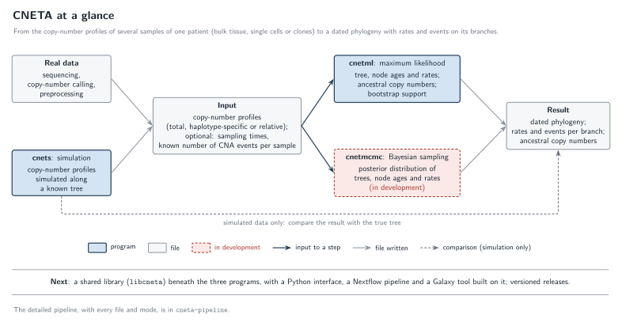
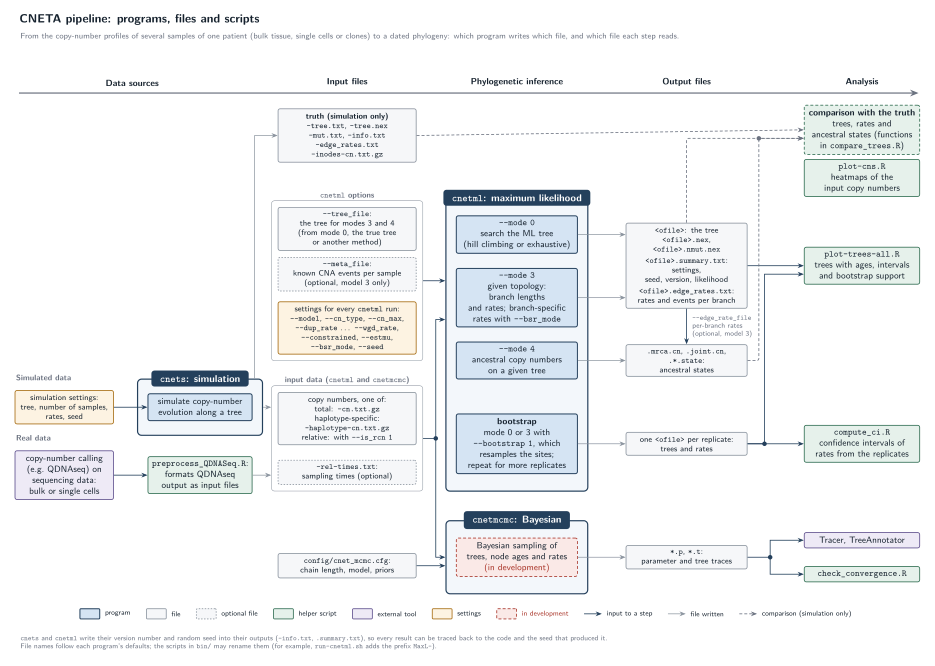

# CNETA pipeline figures

Two figures, drawn in TikZ the same way as the logo in `../logo/`, so they
live under version control and come in a light and a dark variant. The
documentation shows the overview on its home page and the pipeline on the
Workflows page; `docs/source/conf.py` reads them from `svg/`.

## At a glance

<p align="center">
  <picture>
    <source media="(prefers-color-scheme: dark)" srcset="svg/cneta-overview-dark.svg">
    
  </picture>
</p>

What the tools do: real or simulated (`cnets`) copy-number profiles as
input; maximum likelihood (`cnetml`) and Bayesian (`cnetmcmc`, in
development) inference side by side; the result; and what comes next. Source: `cneta-overview.tex`.

## The pipeline in detail

<p align="center">
  <picture>
    <source media="(prefers-color-scheme: dark)" srcset="svg/cneta-pipeline-dark.svg">
    
  </picture>
</p>

How the programs and the `util/` scripts chain together, and which files
cross the boundaries between them. Source: `cneta-pipeline.tex`.

| Use | File |
|---|---|
| Light background | `svg/cneta-overview.svg`, `svg/cneta-pipeline.svg` |
| Dark background | `svg/cneta-overview-dark.svg`, `svg/cneta-pipeline-dark.svg` |
| Slides, chat | `png/` (generated locally by `./build.sh`, not committed) |
| A look while editing | `pdf/` (generated locally by `./build.sh`, not committed) |

## Reading it

- **Colour shows what a box is**: blue a program (`cnets`, `cnetml`,
  `cnetmcmc`), grey a file (dotted border: optional), green a helper script
  in `util/`, purple an external tool, amber settings, red dashed what is
  still in development (`cnetmcmc`). **The column shows its role**: data
  sources, input files, phylogenetic inference, output files, analysis.
- `cnets` and `cnetml` write their version number and random seed into
  their outputs, so every result can be traced back to the code and the seed
  that produced it; `cnetmcmc` will do the same once it is released.

## Editing the figures

Everything is in the two `.tex` files; no drawing program is involved.

- **A box** is one line: `\node[style, text width=36mm] (name) at (x,y) {text};`.
  The style word sets the colour (`prog`, `file`, `optfile`, `script`,
  `tool`, `settings`, `draft`); `(name)` is how arrows refer to the box; `(x,y)` is
  its centre in millimetres, x to the right and y upwards; the braces hold
  the text. Inside the text, `\\` starts a new line, `\textbf{...}` is bold
  and `\f{...}` sets a file name or option in monospace.
- **An arrow** is `\draw[arr] (from) -- (to);` using the box names. `arr` is
  an input to a step, `arrf` a file being written, `arrc` a comparison with
  the truth (simulated data only).
- **To reword** a box, edit its braces. **To move** it, change `(x,y)`.
  **To add** one, copy a node line, give it a new name and position, and add
  its arrows. **To remove** one, delete the node line and the arrows that
  name it.
- **Colours** live in the palette block near the top of each file (one set
  for a light and one for a dark background); change them only there.
- **To look at the result**, run `./build.sh` and open `pdf/cneta-pipeline.pdf`
  or `pdf/cneta-overview.pdf` (the `-dark` PDFs have light text on a
  transparent background, so they look wrong in a PDF viewer; that is
  expected). `pdflatex cneta-pipeline.tex` on its own also works and gives
  the light version. The files compile unchanged on Overleaf too: upload
  the `.tex`, edit there, and copy the text back into the repository.
- **When you are done**, run `./build.sh` with poppler installed (it
  regenerates `svg/`) and commit the `.tex` and `svg/` files together. If
  you do not have poppler, commit the `.tex` only and say so in the pull
  request; the SVGs can be rebuilt by anyone who has it.

## Rebuilding

```bash
./build.sh
```

Needs `pdflatex` (a basic TeX Live or MacTeX, with TikZ and Latin Modern).
With `pdftocairo` (poppler: `brew install poppler`, `apt install
poppler-utils`) it also writes `svg/` and `png/`; without it you still get
`pdf/`. Commit the regenerated `svg/` files together with the source.
