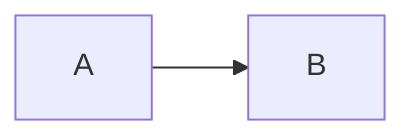

# Working on the documentation

## Project structure

- **`docs/source/`** — documentation source files (Markdown, MyST flavour)
  - **`docs/source/index.md`** — homepage and root `toctree`
  - **`docs/source/<section>/`** — pages grouped by topic (`installation/`,
    `user-guide/`, `developer-guide/`, ...)
  - **`docs/source/conf.py`** — Sphinx configuration
  - **`docs/source/_static/`** — static assets
  - **`docs/source/_templates/`** — theme template overrides (the language
    switcher)
  - **`docs/source/locale/`** — translations, one `.po` file per page (see
    [Translations](#translations))
- **`docs/build/`** — generated HTML/Doxygen XML (gitignored, not committed)
- **`docs/Makefile`** — build automation (see [Everyday use](#everyday-use))
- **`docs/environment.yml`**, **`docs/requirements.txt`** — conda/pip
  dependencies; `requirements.txt` is the single source of truth, pulled in
  by `environment.yml` via pip
- **`docs/Doxyfile`** — Doxygen config for the C++ API pages
- **`.github/workflows/docs.yml`** — CI: builds on every pull request,
  deploys to GitHub Pages on merge to `main`
- **`assets/logo/`** — logo: TikZ source, build script and exported
  SVG/PNG/favicon (see its `README.md`); used by this file and the docs

## One-time setup

Python packages are listed once, in `docs/requirements.txt`. Everything
below installs that same set.

::::{tab-set}
:::{tab-item} conda (recommended)

```bash
conda env create -f docs/environment.yml
conda activate cneta-docs
```

`environment.yml` pulls in `requirements.txt` via pip, and additionally
provides `doxygen`, `graphviz`, and `make`.
:::

:::{tab-item} venv

```bash
python -m venv .venv
source .venv/bin/activate
pip install -r docs/requirements.txt
```

Install `doxygen` and `graphviz` separately — `brew install doxygen
graphviz` or `apt install doxygen graphviz`.
:::

:::{tab-item} uv

```bash
uv venv && source .venv/bin/activate
uv pip install -r docs/requirements.txt
```

Install `doxygen` and `graphviz` separately, as above.
:::
::::

## Adding a dependency

1. Add it to `docs/requirements.txt`.
2. Add it to `extensions` in `docs/source/conf.py` if it is a Sphinx
   extension.
3. Update your local environment:

   ```bash
   conda env update -f docs/environment.yml --prune
   ```

Do not add Python packages to `environment.yml` directly — that would
split the source of truth and quietly break the venv and uv workflows.

## Everyday use

```bash
make -C docs live      # live-reload preview (English) at http://localhost:8080
make -C docs live-zh   # the same for the Chinese site
make -C docs html      # one-off English build into docs/build/html/en
make -C docs html-all  # every language, into docs/build/html/<language>
make -C docs serve     # serve docs/build/html, language switch included
make -C docs strict    # every language, warnings-as-errors; this is what CI runs
make -C docs api       # regenerate the C++ API XML via Doxygen
make -C docs clean
```

If `make strict` passes locally, CI will pass.

The published site has one directory per language (`en/`, `zh_CN/`); the
site root redirects to `en/`. `make live` serves a single language, so the
language switch links only work under `make html-all serve`.

## Writing pages

Pages are Markdown (MyST). Ordinary Markdown works; a few extras are
enabled:

- **Admonitions** — `:::{note}` … `:::`
- **Definition lists** — a term on one line, `: definition` on the next
- **Maths** — `$\lambda$` inline
- **Cross-references** — relative links such as
  `[Quick start](../quickstart/index.md)`

### Mermaid diagrams

Write a normal fenced block:

````markdown

````

`myst_fence_as_directive` in `conf.py` turns these into rendered diagrams,
so the same file displays correctly both here and on GitHub. Keep diagrams
in text form rather than exporting images.

### Adding a page

1. Create the `.md` file in the appropriate section directory.
2. Add it to the `toctree` in that section's `index.md`.

A page not listed in any `toctree` triggers a warning, which fails the
strict build.

## Translations

The English Markdown pages are the only source. Translations are kept as
gettext `.po` files in `docs/source/locale/<language>/LC_MESSAGES/`, one per
page, each pairing an English string (`msgid`) with its translation
(`msgstr`). A string with an empty `msgstr` is shown in English, so a page
can be translated piece by piece.

After changing English pages:

```bash
make -C docs intl-update   # add new strings to every .po file
```

New strings arrive untranslated; strings whose English changed are marked
`#, fuzzy` and shown in English until the translation is updated and the
`fuzzy` line removed. Then fill in `msgstr` and check with
`make -C docs live-zh`.

Keep the Markdown syntax of the English string in the translation:
inline code, links (with the same targets) and emphasis. A link missing
from a translation fails the strict build.

To add a language, add its code to `TRANSLATIONS` in `docs/Makefile`, a
build target like `html-zh`, and an entry in
`_templates/sidebar/lang-switch.html`.

## C++ API pages

Doxygen extracts comments from `code/` (excluding the vendored
`gzstream/`, `lbfgsb/`, and `matexp/` directories) into XML, which Breathe
renders in `api/cpp.md`. Configuration lives in `docs/Doxyfile`.

To document a function so it appears there:

```cpp
/// Compute the log-likelihood of a tree given copy-number data.
///
/// @param tree   the candidate tree
/// @param data   observed copy-number profiles
/// @return the log-likelihood
double get_likelihood(const evo_tree& tree, const CopyNumberData& data);
```

## Conventions

- Prefer Markdown over reStructuredText.
- Keep examples runnable and repository-local.
- Update documentation in the same pull request as the code it describes.
- Scientific content is owned by the research team; infrastructure,
  build/test guidance, and API generation by the RSE team.
